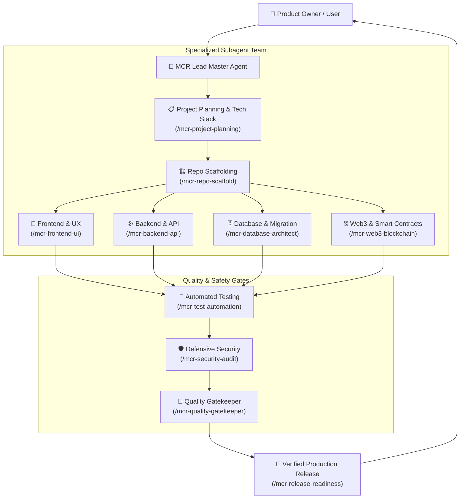

# MCROS — FRONTIER AI OS V3
### Autonomous AI Engineering, Research & Production Operating System
**Created by Maheshwar Chandra Roy (MCR)**

[](https://github.com/maheshwarchandraroy/MCROS/actions)
[](https://opensource.org/licenses/MIT)
[]()
[]()
[]()

---

## 🌟 Overview

**MCROS (Maheshwar Chandra Roy Operating System)** is an open-source, file-based AI operating system that transforms general-purpose conversational LLMs into an elite, multi-agent software engineering and research organization.

Instead of writing unverified code or guessing dependencies, MCROS enforces:
- **Truth Over Confidence**: No task is marked complete without direct terminal execution evidence (passes, exit code 0).
- **Progressive Token Budgeting**: 12 modular rules and 28 skills load on demand without blowing context window token limits.
- **Multi-Agent Orchestration**: Main Agent orchestrates specialized Subagents (Frontend, Backend, Database, QA, Security, Web3).
- **Universal Compatibility**: Works out of the box in Google Antigravity, Anthropic Claude Code, Cursor, Windsurf, and VS Code.
- **Self-Improving Memory**: Logs solved defects in `docs/LESSONS_LEARNED.md` to prevent recurring errors.

---

## 🏛️ System Architecture



---

## ⚡ The 34 Master Skills Catalog

Invoke any skill directly via slash command (`/<skill-name>`) in your AI chat:

| Domain | Skill Name | Slash Command | Description |
|---|---|---|---|
| **Planning** | `mcr-project-planning` | `/mcr-project-planning` | Work Breakdown Structure (WBS), milestones, MVP scoping |
| | `mcr-tech-stack-selector` | `/mcr-tech-stack-selector` | Objective technology evaluation matrix & trade-offs |
| | `mcr-repo-scaffold` | `/mcr-repo-scaffold` | Clean architecture repository initialization |
| | `mcr-project-discovery` | `/mcr-project-discovery` | Existing codebase discovery & dependency mapping |
| **Orchestration** | `mcr-subagent-orchestrator` | `/mcr-subagent-orchestrator` | Multi-agent delegation, parallel execution & synthesis |
| **Product & Specs** | `mcr-product-spec` | `/mcr-product-spec` | Product Requirements Documents (PRD) & user journeys |
| | `mcr-tech-architecture` | `/mcr-tech-architecture` | Component architecture, data contracts & ADR records |
| | `mcr-market-research` | `/mcr-market-research` | Market research, competitive analysis & TAM/SAM/SOM |
| **Frontend & UI** | `mcr-frontend-ui` | `/mcr-frontend-ui` | Accessible (WCAG AA) components, loading/error/empty states |
| | `mcr-responsive-styling` | `/mcr-responsive-styling` | Tailwind CSS, dark mode theming, view transitions |
| **Backend & Architecture** | `mcr-backend-api` | `/mcr-backend-api` | Scalable REST/GraphQL/gRPC APIs & Zod/Pydantic validation |
| | `mcr-backend-clean-architecture` | `/mcr-backend-clean-architecture` | Clean Architecture, DDD, Controller-Service-Repository patterns |
| | `mcr-auth-security` | `/mcr-auth-security` | OAuth 2.0, JWT, sessions, RBAC/ABAC route protection |
| **Database** | `mcr-database-architect` | `/mcr-database-architect` | 3NF relational modeling, composite indexes, query tuning |
| | `mcr-db-migration` | `/mcr-db-migration` | Zero-downtime expand/contract migrations & rollbacks |
| **UX & Branding** | `mcr-brand-logo-design` | `/mcr-brand-logo-design` | Vector SVG logos, favicons, app icons, color palettes |
| | `mcr-ux-interaction-design` | `/mcr-ux-interaction-design` | Click flows, toast notification system, modals & feedback loops |
| | `mcr-motion-animation` | `/mcr-motion-animation` | High-performance 60fps animations, Framer Motion, transitions |
| **Cross-Platform & i18n** | `mcr-crossplatform-mobile-desktop` | `/mcr-crossplatform-mobile-desktop` | Android, iOS, Windows, macOS, Linux native/hybrid apps |
| | `mcr-i18n-localization` | `/mcr-i18n-localization` | Multi-language catalogs (English, Bengali, RTL), locale formats |
| **QA & Debugging** | `mcr-test-automation` | `/mcr-test-automation` | Vitest, Playwright, Pytest automated testing suites |
| | `mcr-debugger-fixer` | `/mcr-debugger-fixer` | Error stack trace analysis & surgical root-cause repair |
| **Quality & Memory**| `mcr-quality-gatekeeper` | `/mcr-quality-gatekeeper` | Anti-hallucination filter & lessons learned learning loop |
| **Security** | `mcr-security-audit` | `/mcr-security-audit` | OWASP Top 10 defensive audits & threat modeling |
| | `mcr-secrets-guard` | `/mcr-secrets-guard` | Plaintext API key leak prevention & .env hygiene |
| **AI Systems** | `mcr-rag-architect` | `/mcr-rag-architect` | Vector DBs, semantic chunking, hybrid search & RAG |
| **Web3** | `mcr-web3-blockchain` | `/mcr-web3-blockchain` | Solidity smart contracts, ERC standards, Foundry fuzzing |
| **DevOps & Cloud** | `mcr-devops-cloud` | `/mcr-devops-cloud` | Docker containerization, GitHub Actions CI/CD pipelines |
| | `mcr-release-readiness` | `/mcr-release-readiness` | Production verification gate & rollback safety check |
| | `mcr-tech-docs` | `/mcr-tech-docs` | OpenAPI/Swagger specs, developer guides & changelogs |

---

## 📜 The 12 System Rules

Rules operate in the background and govern model discipline:

1. **`00-core-operating-contract.md`** (`always_on`): Truth over confidence, non-destructive safety, execution loop.
2. **`15-clean-code-and-documentation.md`** (`always_on`): Professional JSDoc/TSDoc/Docstrings, clean code & logic documentation.
2. **`10-research-and-market-intel.md`** (`model_decision`): Verified evidence standards.
3. **`20-product-and-architecture.md`** (`model_decision`): PRD and system architecture standards.
4. **`30-frontend-engineering.md`** (`glob`): Full component visual state handling.
5. **`40-backend-engineering.md`** (`model_decision`): Strict input validation at perimeter.
6. **`50-database-and-storage.md`** (`model_decision`): Schema normalization and safe migrations.
7. **`60-defensive-security.md`** (`model_decision`): OWASP compliance and defensive assessments.
8. **`70-qa-and-verification.md`** (`model_decision`): Test pyramid and verification evidence.
9. **`80-ai-and-automation.md`** (`model_decision`): Structured output schemas and RAG pipelines.
10. **`85-quality-and-anti-hallucination.md`** (`always_on`): Zero phantom packages, zero incomplete TODOs.
11. **`90-devops-and-release.md`** (`manual`): Production release checklist.
12. **`95-web3-blockchain-safety.md`** (`glob`): Smart contract reentrancy and gas safety.

---

## 🚀 Quick Start

### 1. Verification
Run the one-click validation script:
```bash
bash scripts/setup.sh
# or
python3 scripts/validate_setup.py
```

### 2. Start Developing
Open this repository in **Antigravity**, **Claude Code**, or **Cursor**, and prompt:
```text
"Use the MCROS workflow. I want to build a [describe your application]. First plan the architecture and select the tech stack, scaffold the project, and delegate tasks to specialized subagents. Test and verify all outputs."
```

---

## 📖 Documentation
- [Master Architecture Guide](docs/MCROS_MASTER_GUIDE.md)
- [Quickstart Prompts](docs/QUICKSTART_PROMPTS.md)
- [Lessons Learned Log](docs/LESSONS_LEARNED.md)
- [Contributing Guide](CONTRIBUTING.md)

---

## 📄 License
Released under the [MIT License](LICENSE). Copyright (c) 2026 Maheshwar Chandra Roy (MCR).
