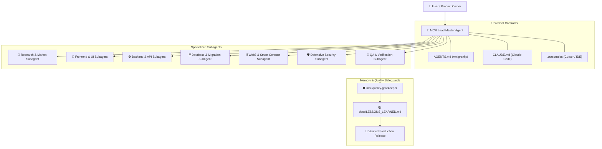

# MCROS Master Architecture Guide & Operating Manual
## Version 3.0 | Created by Maheshwar Chandra Roy (MCR)

---

## 1. Vision & Architecture

**MCROS (Maheshwar Chandra Roy Operating System)** transforms conversational AI agents into an elite, disciplined, autonomous software engineering and research organization.

Instead of outputting unverified code or hallucinated assumptions, MCROS enforces Silicon Valley engineering standards:
1. **Truth Over Confidence**: No claim of completion without executable proof.
2. **Progressive Disclosure**: Rules and skills load only when contextually relevant, preserving context window tokens.
3. **Multi-Agent Orchestration**: A Lead Master Agent delegates discrete tasks to specialized Subagents (Frontend, Backend, Database, Security, QA).
4. **Universal Compatibility**: Works seamlessly across Google Antigravity, Anthropic Claude Code, Cursor, Windsurf, and VS Code.



---

## 2. Directory Layout & Structure

```
MCROS/
├── .agents/
│   ├── rules/          # 12 Modular Rules with Progressive Frontmatter
│   ├── skills/         # 28 Executable Skills (Slash Command Enabled)
│   └── workflows/      # 5 Step-by-Step Production Runbooks
├── .github/
│   └── workflows/      # GitHub Actions CI Automation
├── docs/
│   ├── templates/      # PRD, ADR, Test Plan, Threat Model, Research Report
│   ├── ARCHITECTURE.md # Live System Architecture Document
│   ├── PROJECT_CONTEXT.md # Live Tech Stack & Runbook Document
│   ├── LESSONS_LEARNED.md # Self-Learning Memory & Post-Mortem Log
│   ├── RELEASE_READINESS.md # Pre-Deployment Verification Gate
│   └── SECURITY_REPORT.md   # Defensive Vulnerability Report
├── scripts/
│   ├── setup.sh        # One-Click Initialization Script
│   └── validate_setup.py # Automated Static Validator
├── AGENTS.md           # Primary Antigravity Operating Contract
├── CLAUDE.md           # Anthropic Claude Code Contract
├── .cursorrules        # Cursor & Windsurf Engine Rules
├── .gitignore          # Repository Hygiene Safeguards
├── LICENSE             # MIT Open-Source License
├── CONTRIBUTING.md     # Open-Source Contribution Guide
└── README.md           # Master Overview & Cheatsheet
```

---

## 3. The 28 Master Skills Catalog

Every skill can be invoked directly in chat via `/<skill-name>` or activated autonomously by the agent:

| Domain | Skill Identifier | Slash Command | Primary Purpose |
|---|---|---|---|
| **Planning & Scaffolding** | `mcr-project-planning` | `/mcr-project-planning` | Work Breakdown Structure (WBS), milestones, MVP vs Phase 2 |
| | `mcr-tech-stack-selector` | `/mcr-tech-stack-selector` | Rational technology selection matrix & trade-offs |
| | `mcr-repo-scaffold` | `/mcr-repo-scaffold` | Clean architecture directory & config setup |
| | `mcr-project-discovery` | `/mcr-project-discovery` | Existing codebase inspection & tech stack detection |
| **Orchestration** | `mcr-subagent-orchestrator` | `/mcr-subagent-orchestrator` | Multi-agent task delegation, boundary isolation & synthesis |
| **Product & Architecture** | `mcr-product-spec` | `/mcr-product-spec` | Product Requirements Documents (PRD) & user journeys |
| | `mcr-tech-architecture` | `/mcr-tech-architecture` | System architecture, topology, data contracts & ADRs |
| | `mcr-market-research` | `/mcr-market-research` | TAM/SAM/SOM market sizing & competitive benchmarks |
| **Frontend & UI/UX** | `mcr-frontend-ui` | `/mcr-frontend-ui` | Accessible components (WCAG AA), loading/error/empty states |
| | `mcr-responsive-styling` | `/mcr-responsive-styling` | Tailwind CSS, dark mode, design tokens & transitions |
| **Backend & Auth** | `mcr-backend-api` | `/mcr-backend-api` | REST/GraphQL APIs, Zod/Pydantic validation, rate limiting |
| | `mcr-auth-security` | `/mcr-auth-security` | OAuth 2.0, JWT, sessions, RBAC/ABAC route protection |
| **Database & Storage** | `mcr-database-architect` | `/mcr-database-architect` | Relational 3NF models, indexes, constraints, query tuning |
| | `mcr-db-migration` | `/mcr-db-migration` | Zero-downtime expand/contract migrations & rollbacks |
| **QA & Debugging** | `mcr-test-automation` | `/mcr-test-automation` | Vitest, Playwright, Pytest unit/integration/E2E test suites |
| | `mcr-debugger-fixer` | `/mcr-debugger-fixer` | Stack trace analysis, root cause isolation & surgical repair |
| **Quality & Self-Learning** | `mcr-quality-gatekeeper` | `/mcr-quality-gatekeeper` | Anti-hallucination guardrail & lessons learned learning loop |
| **Cybersecurity** | `mcr-security-audit` | `/mcr-security-audit` | OWASP Top 10 defensive audits & threat modeling |
| | `mcr-secrets-guard` | `/mcr-secrets-guard` | Plaintext credential leak detection & .env hygiene |
| **AI Systems** | `mcr-rag-architect` | `/mcr-rag-architect` | Vector DBs, semantic chunking, hybrid search & RAG |
| **Web3 & Blockchain** | `mcr-web3-blockchain` | `/mcr-web3-blockchain` | Solidity smart contracts, ERC standards, Foundry fuzzing |
| **DevOps & Cloud** | `mcr-devops-cloud` | `/mcr-devops-cloud` | Docker multi-stage builds, CI/CD pipelines, health checks |
| | `mcr-release-readiness` | `/mcr-release-readiness` | Pre-deployment verification gate & rollback safety |
| | `mcr-tech-docs` | `/mcr-tech-docs` | OpenAPI/Swagger specs, developer onboarding & changelogs |

---

## 4. The 12 System Rules Catalog

Rules enforce automated constraints and guidelines without bloating the context window:

1. `00-core-operating-contract.md` (`always_on`): Core operating contract and truth over confidence.
2. `10-research-and-market-intel.md` (`model_decision`): Market research and verified evidence standards.
3. `20-product-and-architecture.md` (`model_decision`): PRD and system architecture criteria.
4. `30-frontend-engineering.md` (`glob: **/*.{tsx,jsx,vue,svelte,html,css,scss}`): Complete frontend UI states.
5. `40-backend-engineering.md` (`model_decision`): Perimeter validation and API reliability.
6. `50-database-and-storage.md` (`model_decision`): Schema normalization and non-destructive migrations.
7. `60-defensive-security.md` (`model_decision`): OWASP compliance and defensive assessments.
8. `70-qa-and-verification.md` (`model_decision`): Testing pyramid and verification gates.
9. `80-ai-and-automation.md` (`model_decision`): Structured output schemas and RAG pipelines.
10. `85-quality-and-anti-hallucination.md` (`always_on`): Zero fake packages, zero incomplete TODOs.
11. `90-devops-and-release.md` (`manual`): Production release checklist.
12. `95-web3-blockchain-safety.md` (`glob: **/*.{sol,vy}`): Smart contract reentrancy and gas safety.

---

## 5. End-to-End Execution Tutorial

### Step 1: Initialize Workspace
```bash
git clone <your-repo>
cd <your-repo>
bash scripts/setup.sh
```

### Step 2: Start a Project from Idea to Launch
Prompt your AI Agent:
```text
"Use the MCROS workflow. I want to build a [describe product]. First run /mcr-project-planning and /mcr-tech-stack-selector. Scaffold the repository with /mcr-repo-scaffold, then delegate tasks to subagents. Execute automated tests, perform a defensive security review, and provide a verified release report."
```

The system will autonomously execute the entire engineering lifecycle, providing verified evidence at every stage.
